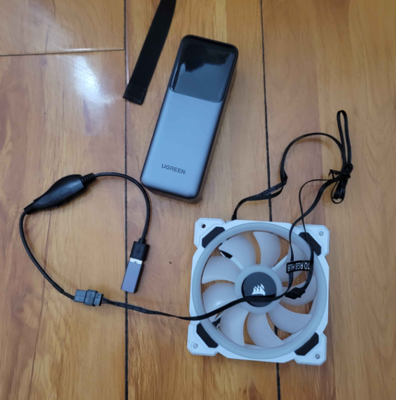

# Phone-cooler
Repurposed pc fan into a phone cooler

# BOM

Fan setup:
1x Corsair fan (I took this one out of the h100i platinum AIO cooler)

1x usb to pin (Gebildet 12V Voltage Step-Up USB to 3-Pin and 4-Pin PC Fan Sleeved Power Adapter Cable with Switch and Speed Regulator) https://www.amazon.com/dp/B0DDT78NTK?ref=ppx_yo2ov_dt_b_fed_asin_title

1x female to female usbc to usb converter (Basesailor USB C Female to USB Female Adapter,TypeC to Type A 3.2 Converter) note: this can be optional if you can connect it to power

1x copper plate (optional), I took this straight out of an AIO

### Power
1x usbc female phone charger brick (generic)

OR

1x Power bank (UGREEN Nexode Pro 165W 20000mAh Power Bank) $55

Case/Frame:
3d printed PLA filament

# Reasoning
So, the main elements of this build is the fan, and the copper plate, the copper plate being a great conductor for heat, which can take in most heat from the phone. Now, there is heat inside the copper with not much to go, which comes in the fan, which can blow air onto the copper plate, for airflow, and heat flow.

# Analysis
So, after plugging in from the Fan --> female to female usb to usbc --> usbc power bank, what I got is a fan spinning. The brand that I bought from Amazon had 3 switches, R turned the fan on, I and F turned it off.

From 1.5W, the fan spun at a moderate speed.

# Notes
Most of the stuff I have here I already have, I have only bought the adapters, which costed me around $10-15 total.

For this project, I am trying to be as transparent as possible, prices, what I see, etc.
